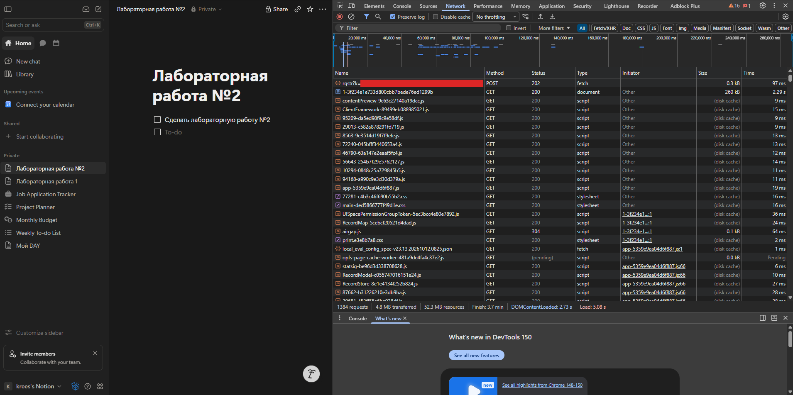
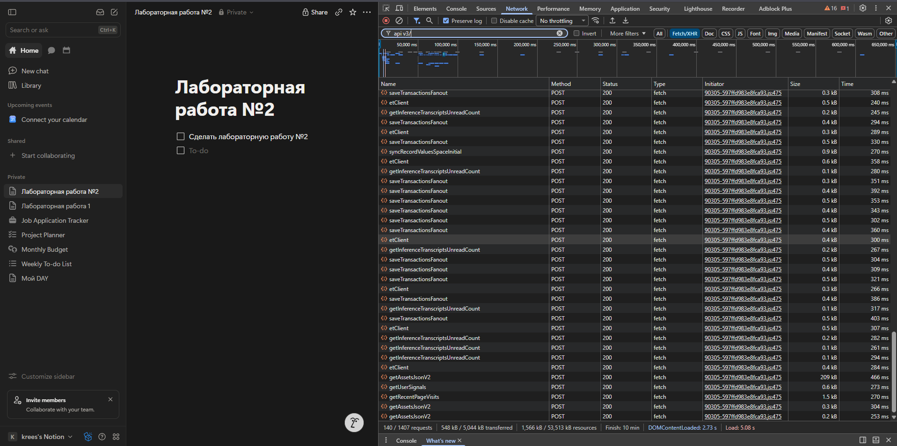
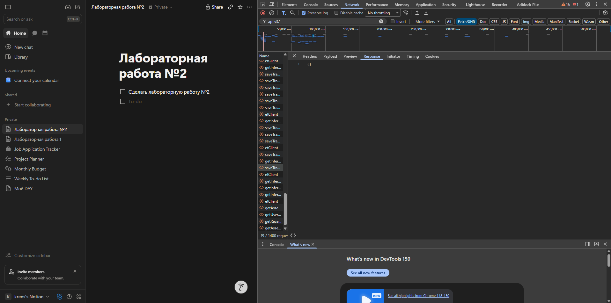
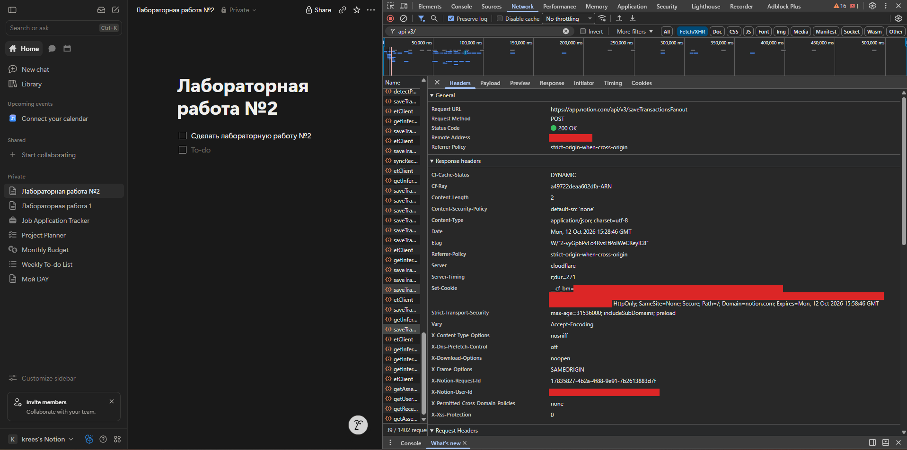
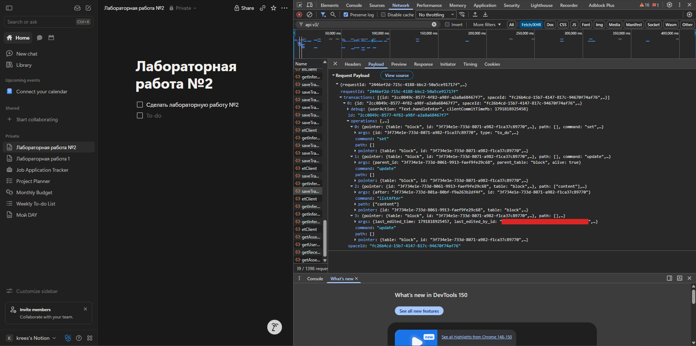
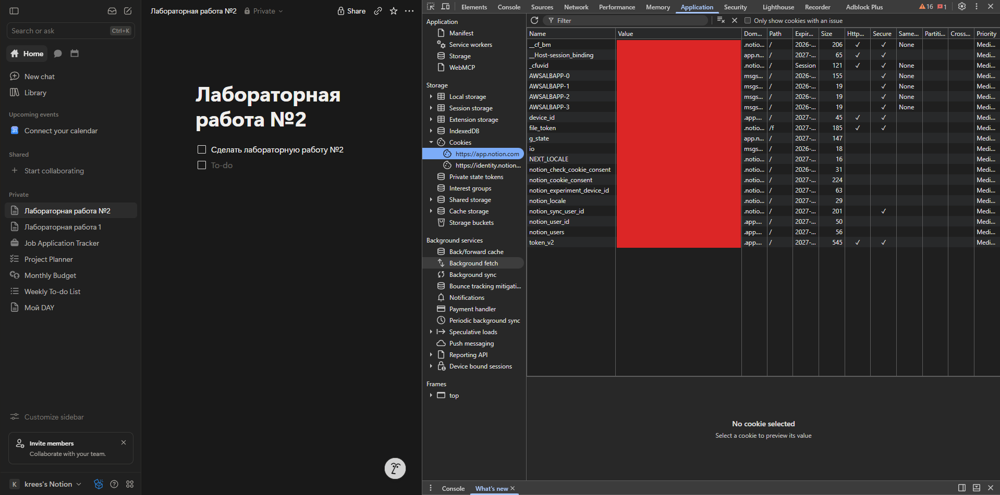
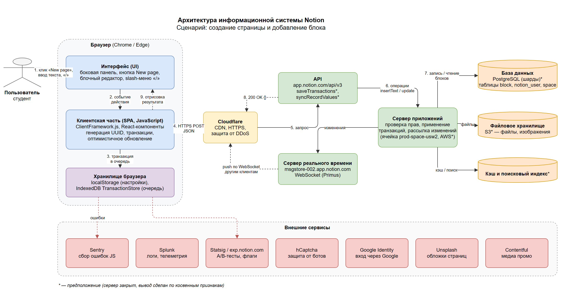
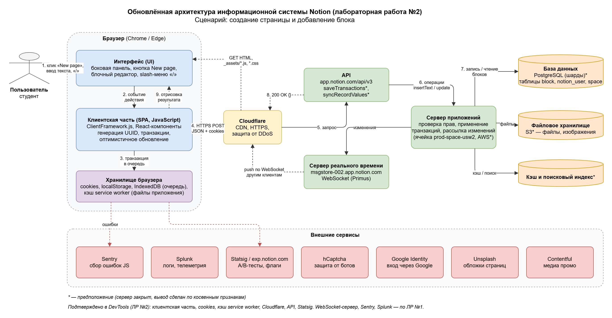
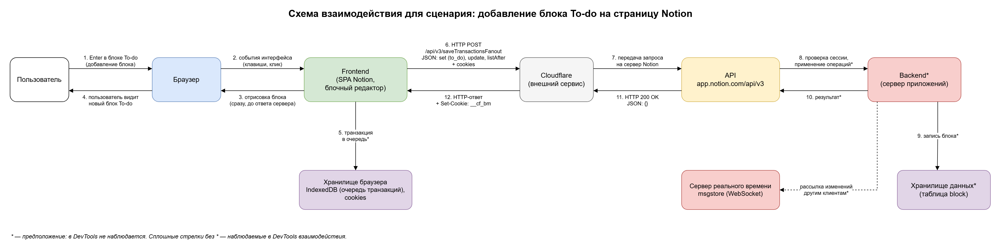

# Лабораторная работа №2

## Анализ веб-приложения и клиент-серверного взаимодействия

## 1. Исследуемая информационная система

Работа продолжает лабораторную работу №1. Исследуется тот же сервис и тот же сценарий (вариант 5):
сервис **Notion** (https://www.notion.com), сценарий — **создание страницы и добавление блока**.

Notion — облачный SaaS-сервис для заметок, документов и баз знаний. Страница в Notion состоит из блоков
(текст, заголовки, списки, чек-листы и т.д.). Пользователь работает в веб-интерфейсе, который отправляет
запросы на сервер, а сервер сохраняет изменения и возвращает данные.

Архитектура из лабораторной работы №1 для исследования выделено следующее:

- браузер ;
- интерфейс и клиентская часть (frontend) — одностраничное приложение на JavaScript;
- хранилище браузера (cookies, `localStorage`, `IndexedDB`);
- Cloudflare — точка входа перед серверами Notion;
- API `app.notion.com/api/v3`;
- backend (сервер приложений) и сервер реального времени (WebSocket);
- хранилища данных;
- внешние сервисы (Sentry, Splunk, Statsig и др.).

### 1.1. Сценарий исследования

Исследуемый сценарий:

1. Авторизация в Notion и открытие рабочего пространства.
2. Нажатие кнопки «New page» в боковой панели и выбор пункта **Page**.
3. Ввод заголовка страницы «Лабораторная работа №2».
4. Переход к первому блоку страницы (Enter).
5. Ввод символа «/» и выбор блока **To-do list** в меню блоков.
6. Ввод текста блока «Сделать лабораторную работу №2».
7. Нажатие Enter — на страницу добавляется следующий блок To-do.
8. Проверка результата: страница появилась в боковой панели, блоки — на странице.

Исследование проводилось в браузере yandex. Перед выполнением сценария в DevTools была открыта вкладка
**Network**, включён параметр **Preserve log** и очищен список запросов. Затем страница была обновлена
и выполнен сценарий.

## 2. Анализ HTTP-запросов

Для изучения сетевого взаимодействия использовалась вкладка **Network** в DevTools. Сначала были изучены
запросы, которые выполняются при открытии страницы, затем — запросы, которые появляются при выполнении сценария.

### 2.1. Основные наблюдения

За время исследования браузер выполнил **1407 запросов** (4,8 МБ передано по сети, 52 МБ ресурсов с учётом кэша).
Событие `DOMContentLoaded` наступило через 2,73 с, событие `Load` — через 5,08 с.

Были замечены следующие типы HTTP-запросов:

- `GET`-запрос HTML-документа страницы;
- `GET`-запросы файлов JavaScript и CSS — их большинство;
- `POST`-запросы к API `/api/v3/…` для получения данных и сохранения изменений;
- служебные запросы (конфигурация, отправка событий).

Наблюдаемый факт: в просмотренных запросах используются два HTTP-метода — `GET` и `POST`.

Наблюдаемый факт: все обращения к API Notion — это `POST`-запросы на адреса вида
`https://app.notion.com/api/v3/<имя метода>`. По фильтру `api/v3` найдено **140 запросов из 1407**; все просмотренные
запросы выполнены методом `POST`, имеют статус `200` и тип `fetch`. Даже чтение данных (`syncRecordValuesSpaceInitial`,
`getRecentPageVisits`) выполняется методом `POST`, а не `GET`.

Наблюдаемый факт: файлы приложения (JavaScript, CSS) загружаются методом `GET`. Это ресурсы, которые загружаются
непосредственно как файлы. Большая часть из них берётся не из сети: в колонке **Size** указано `(disk cache)`,
а у многих запросов в колонке **Initiator** стоит `sw.js` — их выполняет service worker.

В просмотренных запросах встречаются три статус-кода:

| Статус | Значение                                  | Пример запроса                          |
|--------|-------------------------------------------|-----------------------------------------|
| `200`  | Успешно, в ответе есть данные             | документ страницы, запросы к API        |
| `202`  | Принято к обработке                       | `POST …/rgstr` (отправка событий)       |
| `304`  | Файл не изменился, берётся копия из кэша  | `GET airgap.js`                         |

### 2.2. Таблица HTTP-запросов

Значения cookies, ключи и полные идентификаторы в таблице не приводятся.

| №  | Метод | URL / тип запроса                             | Статус | Тип        | Назначение                                              |
|----|-------|-----------------------------------------------|--------|------------|---------------------------------------------------------|
| 1  | GET   | `https://app.notion.com/p/{id страницы}`      | 200    | document   | Загрузка HTML-документа приложения (260 кБ)             |
| 2  | GET   | `ClientFramework-….js`                        | 200    | script     | Загрузка JavaScript клиентской части (из кэша)          |
| 3  | GET   | `app-….js`                                    | 200    | script     | Загрузка основного JavaScript приложения (из кэша)      |
| 4  | GET   | `main-….css`                                  | 200    | stylesheet | Загрузка стилей интерфейса (из кэша)                    |
| 5  | GET   | `airgap.js`                                   | 304    | script     | Проверка файла: не изменился, взят из кэша              |
| 6  | GET   | `local_eval_config_spec-….json`               | 200    | fetch      | Загрузка конфигурации клиента                           |
| 7  | POST  | `…/rgstr?k=…`                                 | 202    | fetch      | Отправка событий в сервис экспериментов                 |
| 8  | POST  | `/api/v3/syncRecordValuesSpaceInitial`        | 200    | fetch      | Получение данных рабочего пространства                  |
| 9  | POST  | `/api/v3/saveTransactionsFanout`              | 200    | fetch      | Сохранение изменений: страница, блок, текст             |
| 10 | POST  | `/api/v3/etClient`                            | 200    | fetch      | Отправка аналитических событий                          |
| 11 | POST  | `/api/v3/getInferenceTranscriptsUnreadCount`  | 200    | fetch      | Счётчик непрочитанных записей Notion AI                 |
| 12 | POST  | `/api/v3/getRecentPageVisits`                 | 200    | fetch      | Список недавно открытых страниц                         |
| 13 | POST  | `/api/v3/getUserSignals`                      | 200    | fetch      | Получение данных о пользователе                         |
| 14 | POST  | `/api/v3/getAssetsJsonV2`                     | 200    | fetch      | Получение списка файлов приложения (209 кБ)             |

Запросы 1–6 — ресурсы, которые загружаются как файлы. Запросы 8–14 относятся к API Notion.

Назначение запросов 6, 7, 11–14 определено по их названиям и является **предположением**. Запрос 7 относится
к сервису экспериментов Statsig предположительно: рядом с ним загружается файл `statsig-….js`.



*Скрин 1. Запросы при открытии страницы: HTML-документ, файлы JavaScript и CSS*



*Скрин 2. Запросы к API (фильтр `api/v3`): все выполняются методом POST*

### 2.3. Запросы, относящиеся к сценарию

К выбранному сценарию относятся запросы, которые появились в списке после действий пользователя.

Наблюдаемый факт: каждое изменение на странице (создание страницы, ввод заголовка, добавление блока, ввод текста)
вызывает запрос `POST /api/v3/saveTransactionsFanout`. Пока пользователь печатает, такие запросы идут один
за другим — на скрине 2 их больше десяти.

Наблюдаемый факт: рядом с запросами сохранения периодически выполняются `etClient` (аналитика)
и `getInferenceTranscriptsUnreadCount`. К действиям пользователя на странице они не относятся.

Наблюдаемый факт: открытие меню блоков («/») не вызывает запросов к серверу — меню строится на клиенте.

Предположение: запрос сохранения обрабатывается сервером приложений, который проверяет права пользователя,
применяет операции и сохраняет изменения в базе данных.

## 3. Анализ HTTP-ответов

Для анализа выбраны два запроса: загрузка страницы приложения и сохранение добавленного блока.

### 3.1. Ответ на запрос страницы

Запрос: `GET https://app.notion.com/p/{id страницы}` (первая строка с типом `document` на скрине 1).

- Статус: `200` — страница успешно загружена.
- Тип возвращаемых данных: `document`, то есть HTML.
- Размер ответа: 260 кБ, время загрузки — 2,29 с.
- Тело ответа: HTML-документ, который подключает JavaScript и CSS приложения. После него браузер загружает
  файлы `ClientFramework-….js`, `app-….js`, `main-….css` и другие.

Содержимое страницы (заголовок, блоки) браузер получает отдельными запросами к API.

### 3.2. Ответ на запрос добавления блока

Запрос: `POST https://app.notion.com/api/v3/saveTransactionsFanout`.

- Статус: `200 OK` — сервер принял изменения.
- Тип возвращаемых данных: `application/json; charset=utf-8`.
- Размер тела ответа: 2 байта (`Content-Length: 2`).
- Тело ответа:

```json
{}
```

Пустой JSON-объект — это подтверждение: сервер применил операции, дополнительных данных браузеру не требуется.
Новый блок уже отображается на странице, потому что интерфейс обновился до ответа сервера.



*Скрин 3. Тело ответа на запрос `saveTransactionsFanout`*

Основные заголовки ответа:

| Заголовок                   | Значение                                       | Что означает                                          |
|-----------------------------|------------------------------------------------|-------------------------------------------------------|
| `Content-Type`              | `application/json; charset=utf-8`              | Данные возвращаются в формате JSON                    |
| `Content-Length`            | `2`                                            | Размер тела ответа — 2 байта (`{}`)                   |
| `Date`                      | `Mon, 12 Oct 2026 15:28:46 GMT`                | Дата и время ответа                                   |
| `Server`                    | `cloudflare`                                   | Ответ пришёл через Cloudflare                         |
| `Cf-Ray`                    | `…-ARN`                                        | Идентификатор запроса в Cloudflare и код узла         |
| `Cf-Cache-Status`           | `DYNAMIC`                                      | Ответ API не кэшируется                               |
| `Server-Timing`             | `r;dur=271`                                    | Время обработки запроса на сервере — 271 мс           |
| `Set-Cookie`                | `__cf_bm=…; HttpOnly; Secure; SameSite=None`   | Сервер устанавливает cookie (значение скрыто)         |
| `Strict-Transport-Security` | `max-age=31536000; includeSubDomains; preload` | Работа только по HTTPS                                |
| `X-Notion-Request-Id`       | UUID                                           | Идентификатор запроса на стороне сервера              |
| `X-Notion-User-Id`          | UUID (скрыт)                                   | Идентификатор пользователя, от имени которого запрос  |
| `X-Frame-Options`           | `SAMEORIGIN`                                   | Запрет встраивания страницы на чужие сайты            |
| `X-Content-Type-Options`    | `nosniff`                                      | Браузер не должен угадывать тип данных                |



*Скрин 4. Статус и заголовки ответа на запрос `saveTransactionsFanout`*

### 3.3. Наблюдаемые факты и предположения

Наблюдаемый факт: сервер отвечает на запрос добавления блока статусом `200` и JSON-объектом `{}`.

Наблюдаемый факт: в заголовках ответа указано `Server: cloudflare`, а cookie `__cf_bm` устанавливается для домена
`notion.com` — между браузером и серверами Notion находится Cloudflare.

Наблюдаемый факт: сервер определил пользователя — в ответе есть заголовок `X-Notion-User-Id`, хотя в теле запроса
и в URL пользователь не указан явно как отправитель.

Предположение: пользователь определяется по cookies сессии, которые браузер отправляет с запросом.

Предположение: backend проверяет права доступа, применяет операции к записям и сохраняет новое состояние страницы.

Предположение: суффикс `ARN` в заголовке `Cf-Ray` — код узла Cloudflare, через который прошёл запрос.

## 4. Анализ параметров и передаваемых данных

Для анализа выбран запрос `POST /api/v3/saveTransactionsFanout`, который появился после нажатия Enter в блоке
To-do, то есть при добавлении на страницу нового блока.

### 4.1. Параметры запроса

В теле запроса (JSON):

- `requestId` — идентификатор запроса;
- `transactions[]` — список транзакций, в каждой:
  - `id` — идентификатор транзакции;
  - `spaceId` — идентификатор рабочего пространства;
  - `debug` — служебные данные: действие пользователя (`userAction: "Text.handleEnter"`) и время на клиенте;
  - `operations[]` — список операций.

Каждая операция содержит:

- `command` — команду (`set`, `update`, `listAfter`);
- `pointer` — указатель на запись: таблица (`block`) и идентификатор блока;
- `path` — путь к изменяемому полю записи;
- `args` — аргументы операции.

В запросе добавления блока четыре операции:

| № | Команда     | Запись                 | Что делает                                                                 |
|---|-------------|------------------------|----------------------------------------------------------------------------|
| 0 | `set`       | новый блок             | Создаёт запись блока: идентификатор и тип `to_do`                          |
| 1 | `update`    | новый блок             | Задаёт родителя (`parent_id` — страница, `parent_table: "block"`), `alive: true` |
| 2 | `listAfter` | страница, поле `content` | Вставляет идентификатор нового блока в список блоков страницы после предыдущего |
| 3 | `update`    | новый блок             | Записывает время и автора последнего изменения                             |

В заголовках и cookies передаются служебные данные: тип содержимого, версия клиента, сведения о браузере
и cookies сессии. Значения заголовков запроса и cookies в отчёт не переносятся.

### 4.2. Где находятся данные

- в URL — только имя метода API (`/api/v3/saveTransactionsFanout`), параметров query string нет;
- основная часть данных — в теле HTTP-запроса (payload) в формате JSON;
- служебные данные — в заголовках запроса и cookies.

Структура тела запроса (сокращено, идентификаторы обрезаны):

```json
{
  "requestId": "2446ef2d-…",
  "transactions": [{
    "id": "2cc0849c-…",
    "spaceId": "fc26b4cd-…",
    "debug": { "userAction": "Text.handleEnter", "clientCommitTimeMs": 1791818925458 },
    "operations": [
      {
        "pointer": { "table": "block", "id": "…f1ca37c89770" },
        "path": [],
        "command": "set",
        "args": { "id": "…f1ca37c89770", "type": "to_do" }
      },
      {
        "pointer": { "table": "block", "id": "…f1ca37c89770" },
        "path": [],
        "command": "update",
        "args": { "parent_id": "…faef9fe29c68", "parent_table": "block", "alive": true }
      },
      {
        "pointer": { "table": "block", "id": "…faef9fe29c68" },
        "path": ["content"],
        "command": "listAfter",
        "args": { "after": "…f9a263b2df4f", "id": "…f1ca37c89770" }
      },
      {
        "pointer": { "table": "block", "id": "…f1ca37c89770" },
        "path": [],
        "command": "update",
        "args": { "last_edited_time": 1791818925457, "last_edited_by_id": "…" }
      }
    ]
  }]
}
```

### 4.3. Какие данные передаются при добавлении блока

Сервер получает:

- в каком рабочем пространстве выполняется действие (`spaceId`);
- идентификатор и тип нового блока (`to_do`);
- к какой странице относится блок (`parent_id`);
- в какое место страницы его нужно вставить (`listAfter`, `after` — идентификатор предыдущего блока);
- когда и кем блок был изменён.

Наблюдаемый факт: идентификатор нового блока есть уже в запросе, то есть его создаёт клиент, а не сервер.

Наблюдаемый факт: на сервер передаётся не страница целиком, а только операции над записями.

Наблюдаемый факт: и блок, и страница адресуются одинаково — `table: "block"`. Страница хранится как блок,
в поле `content` которого находится список идентификаторов дочерних блоков.

Сервер возвращает подтверждение `{}` со статусом `200`.



*Скрин 5. Тело запроса `saveTransactionsFanout` при добавлении блока To-do*

## 5. Анализ cookies

Cookies — небольшие данные, которые браузер хранит и отправляет серверу при последующих запросах.

### 5.1. Что было обнаружено

Cookies просмотрены во вкладке **Application → Storage → Cookies → `https://app.notion.com`**. Для этого адреса
браузер хранит 20 cookies. Значения cookies в отчёт не переносятся, на скриншоте они скрыты.

Колонки Domain и Expires на скриншоте обрезаны, поэтому домен указан по видимому началу, а срок действия —
с точностью до года.

| Имя cookie                    | Домен             | Срок действия        | Назначение                                    | Флаги                             | Комментарий                                                                 |
|-------------------------------|-------------------|----------------------|-----------------------------------------------|-----------------------------------|-----------------------------------------------------------------------------|
| `token_v2`                    | `.app.notion.com` | истекает в 2027 г.   | авторизация, сессия пользователя              | HttpOnly, Secure                  | предположение: самая большая cookie (545 байт), недоступна для JavaScript   |
| `notion_user_id`              | `.app.notion.com` | истекает в 2027 г.   | идентификатор текущего пользователя           | —                                 | наблюдаемый факт: значение совпадает с заголовком ответа `X-Notion-User-Id` |
| `notion_users`                | `.app.notion.com` | истекает в 2027 г.   | список аккаунтов, вошедших в браузере         | —                                 | предположение по названию                                                   |
| `device_id`                   | `.app.notion.com` | истекает в 2027 г.   | идентификатор устройства                      | HttpOnly, Secure                  | предположение по названию                                                   |
| `__cf_bm`                     | `.notion.com`     | 30 минут             | защита от ботов Cloudflare                    | HttpOnly, Secure, SameSite=None   | наблюдаемый факт: устанавливается заголовком `Set-Cookie` ответа API        |
| `_cfuvid`                     | `.notion.com`     | сессия               | служебная cookie Cloudflare                   | HttpOnly, Secure, SameSite=None   | предположение по названию                                                   |
| `notion_locale`               | `.notion.com`     | истекает в 2027 г.   | язык интерфейса                               | —                                 | предположение по названию                                                   |
| `notion_check_cookie_consent` | `.notion.com`     | истекает в 2026 г.   | нужно ли показывать окно согласия на cookies  | —                                 | предположение по названию                                                   |
| `notion_experiment_device_id` | `.notion.com`     | истекает в 2027 г.   | участие в экспериментах (A/B-тесты)           | —                                 | предположение по названию                                                   |
| `AWSALBAPP-0`                 | `msgs…`           | истекает в 2026 г.   | привязка клиента к серверу за балансировщиком | Secure, SameSite=None             | предположение: имя стандартной cookie балансировщика нагрузки AWS           |
| `g_state`                     | `app.notion.com`  | истекает в 2027 г.   | состояние входа через Google                  | —                                 | предположение по названию                                                   |

### 5.2. Анализ результатов

Наблюдаемый факт: cookies установлены для разных доменов — `.notion.com`, `.app.notion.com`, `app.notion.com`
и для домена, начинающегося на `msgs…`.

Наблюдаемый факт: cookies, связанные с сессией и устройством (`token_v2`, `device_id`, `__cf_bm`), имеют флаги
`HttpOnly` и `Secure`: они недоступны из JavaScript и передаются только по HTTPS. Cookies с настройками
(`notion_locale`, `notion_check_cookie_consent`) таких флагов не имеют.

Наблюдаемый факт: флаг `SameSite=None` установлен только у cookies Cloudflare и балансировщика, у остальных
cookies значение `SameSite` не задано.

Предположение: `token_v2` отвечает за авторизацию — по ней сервер определяет пользователя и возвращает его
идентификатор в заголовке `X-Notion-User-Id`.

Предположение: домен `msgs…` — это сервер реального времени `msgstore-…app.notion.com`, обнаруженный
в лабораторной работе №1. Cookie `AWSALBAPP` указывает на то, что перед ним стоит балансировщик нагрузки AWS.




*Скрин 6. Cookies во вкладке Application (значения скрыты)*

## 6. Взаимодействие Frontend, API и Backend

### 6.1. Последовательность событий

- Пользователь
- Интерфейс редактора
- JavaScript (клиентская часть)
- HTTP-запрос
- API
- Backend
- HTTP-ответ
- JavaScript
- Обновление интерфейса

### 6.2. Конкретное действие

Рассмотрим действие: пользователь нажимает Enter в блоке To-do, и на страницу добавляется новый блок To-do.

1. Пользователь нажимает Enter в конце текста блока «Сделать лабораторную работу №2».
2. На действие реагирует блочный редактор — редактируемый элемент блока (`div.notion-to_do-block`).
   В запросе это действие названо `Text.handleEnter`.
3. JavaScript создаёт новый блок, генерирует его идентификатор и сразу показывает блок на странице.
4. JavaScript формирует транзакцию из четырёх операций и отправляет запрос
   `POST https://app.notion.com/api/v3/saveTransactionsFanout`.
5. Запрос уходит на `app.notion.com` и проходит через Cloudflare.
6. В теле запроса передаются идентификатор рабочего пространства, идентификатор и тип блока (`to_do`),
   идентификатор страницы и место вставки; вместе с запросом отправляются cookies.
7. Сервер возвращает ответ `200 OK` с телом `{}`.
8. Пользователь видит новый пустой блок To-do под первым. Блок появился ещё на шаге 3, ответ сервера только
   подтверждает сохранение.

Шаги 1–4, 6–8 наблюдаются в интерфейсе и в DevTools. То, что происходит на сервере между шагами 6 и 7, —
предположение: backend определяет пользователя по cookies, проверяет права на страницу, применяет операции
и записывает блок в базу данных.

### 6.3. Вывод по архитектуре

Наблюдаемый факт: клиент и сервер взаимодействуют по HTTP. Интерфейс обновляется без перезагрузки страницы:
JavaScript отправляет запросы к API и получает ответы в формате JSON.

Особенность Notion: интерфейс обновляется сразу, не дожидаясь ответа сервера, а ответ сервера только
подтверждает сохранение. Поэтому в ответе нет данных блока — они уже есть у клиента.

## 7. Сопоставление с архитектурой из лабораторной работы №1

В лабораторной работе №1 была построена архитектурная схема Notion. Во второй работе она сопоставлена
с наблюдаемым HTTP-взаимодействием.



*Скрин 7. Архитектурная схема из лабораторной работы №1*

### 7.1. Что удалось подтвердить

| Компонент схемы                    | Чем подтверждается                                                              |
|------------------------------------|---------------------------------------------------------------------------------|
| Браузер и интерфейс                | Действия пользователя вызывают запросы во вкладке Network                       |
| Клиентская часть (SPA, JavaScript) | `GET`-запросы файлов `ClientFramework-….js`, `app-….js`; запросы типа `fetch`   |
| Хранилище браузера                 | Cookies во вкладке Application; файлы приложения берутся из кэша                |
| Cloudflare                         | Заголовки ответа `Server: cloudflare`, `Cf-Ray`, cookie `__cf_bm`               |
| API `app.notion.com/api/v3`        | 140 `POST`-запросов: `saveTransactionsFanout`, `syncRecordValuesSpaceInitial`   |
| Сервис экспериментов (Statsig)     | Файл `statsig-….js` и запрос `POST …/rgstr` со статусом `202`                   |

Взаимодействия, которые удалось наблюдать непосредственно:

- браузер → сервер: `GET`-запрос документа и файлов приложения;
- клиентская часть → Cloudflare → API: `POST`-запросы с JSON и ответы на них;
- сервер → браузер: установка cookie заголовком `Set-Cookie`;
- клиентская часть → сервис экспериментов: отправка событий.

### 7.2. Предположения  

Из DevTools не видно, что происходит за API, поэтому предположениями остаются:

- как устроен сервер приложений и на каком языке он написан;
- какая база данных используется (PostgreSQL — предположение из лабораторной работы №1);
- есть ли файловое хранилище, кэш и поисковый индекс и как они устроены;
- как сервер приложений передаёт изменения серверу реального времени;
- у какого провайдера размещены серверы (cookie `AWSALBAPP` указывает на AWS, но это косвенный признак).

Сервер реального времени (WebSocket) и сервисы Sentry и Splunk наблюдались в лабораторной работе №1.
В этой работе они отдельно не исследовались; о сервере реального времени косвенно говорят cookies домена `msgs…`.

### 7.3. Новые связи и дополнение архитектурной схемы

В ходе исследования обнаружены связи, которых не было на схеме из лабораторной работы №1:

- **cookies** — хранятся в браузере и отправляются с каждым запросом к API; по ним сервер определяет пользователя
  (в ответе возвращается `X-Notion-User-Id`);
- **service worker и кэш** — большая часть файлов приложения загружается не с сервера, а из кэша браузера
  (`disk cache`, инициатор `sw.js`);
- **Cloudflare устанавливает собственную cookie** (`__cf_bm`) в ответах API;
- **загрузка файлов и обмен данными разделены**: файлы — `GET`, данные — `POST /api/v3/…`.

Схема дополнена: в хранилище браузера добавлены cookies и кэш service worker, показана загрузка файлов
приложения отдельно от запросов к API.



*Скрин 8. Обновлённая архитектурная схема Notion*

Исходный файл схемы: [`schemas/lab2-architecture.drawio`](schemas/lab2-architecture.drawio).

## 8. Схема взаимодействия компонентов

На основании проведённого анализа построена отдельная схема взаимодействия компонентов для сценария
добавления блока.



*Скрин 9. Схема взаимодействия компонентов при добавлении блока To-do*

Исходный файл схемы: [`schemas/lab2-scenario.drawio`](schemas/lab2-scenario.drawio).


## 9. Вывод

В ходе лабораторной работы исследовано HTTP-взаимодействие веб-приложения Notion на сценарии
«создание страницы и добавление блока».

Основные результаты:

- при открытии страницы браузер выполняет более тысячи запросов; большая часть — `GET`-запросы файлов JavaScript
  и CSS, многие из которых берутся из кэша;
- весь обмен данными идёт `POST`-запросами к API `/api/v3/…` в формате JSON;
- добавление блока сопровождается запросом `POST /api/v3/saveTransactionsFanout` с четырьмя операциями
  и ответом `200 OK` с телом `{}`;
- данные передаются в теле запроса, служебные данные — в заголовках и cookies;
- на сервер отправляются операции над записями, а не страница целиком;
- cookies сессии защищены флагами `HttpOnly` и `Secure`;
- интерфейс обновляется без перезагрузки страницы и раньше, чем приходит ответ сервера.

Современное веб-приложение — распределённая система: пользователь работает с интерфейсом, frontend формирует
запросы, API принимает их, backend обрабатывает и сохраняет данные. Факты в отчёте подтверждены в DevTools,
а выводы о внутреннем устройстве сервера отмечены как предположения, потому что без доступа к серверной части
установить их точно нельзя.

### 9.1. Результаты работы

- Подтверждено: HTTP-запросы при открытии страницы и при работе с редактором, методы `GET` и `POST`.
- Подтверждено: взаимодействие frontend и сервера через API в формате JSON.
- Подтверждено: использование cookies и заголовков HTTP, участие Cloudflare.
- Подтверждено: обновление интерфейса без перезагрузки страницы.
- Предположительно: устройство backend, база данных и внутренние сервисы.
