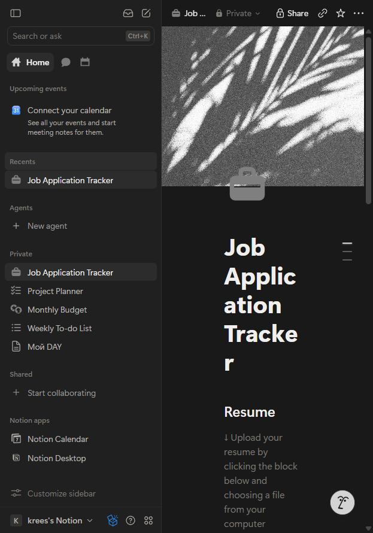
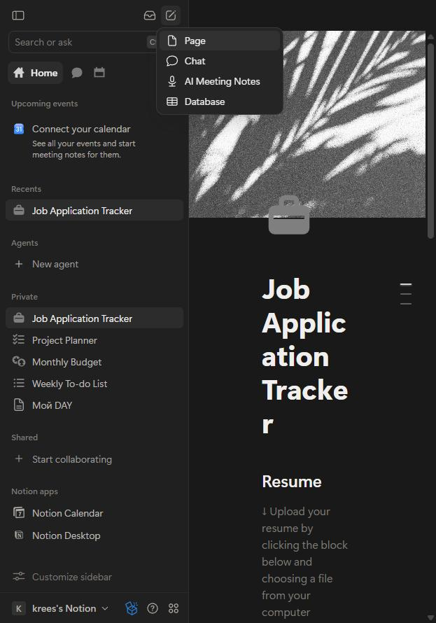
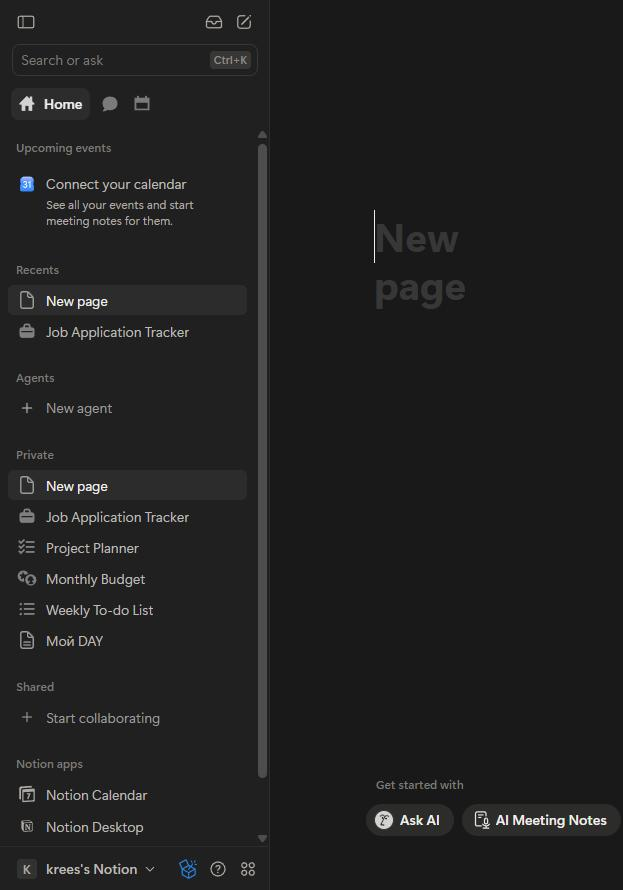
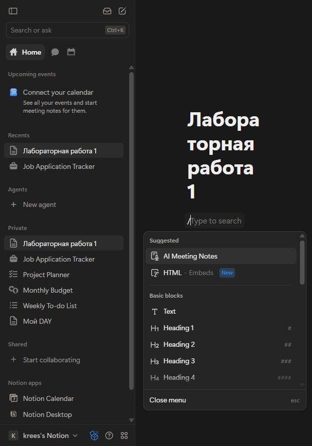
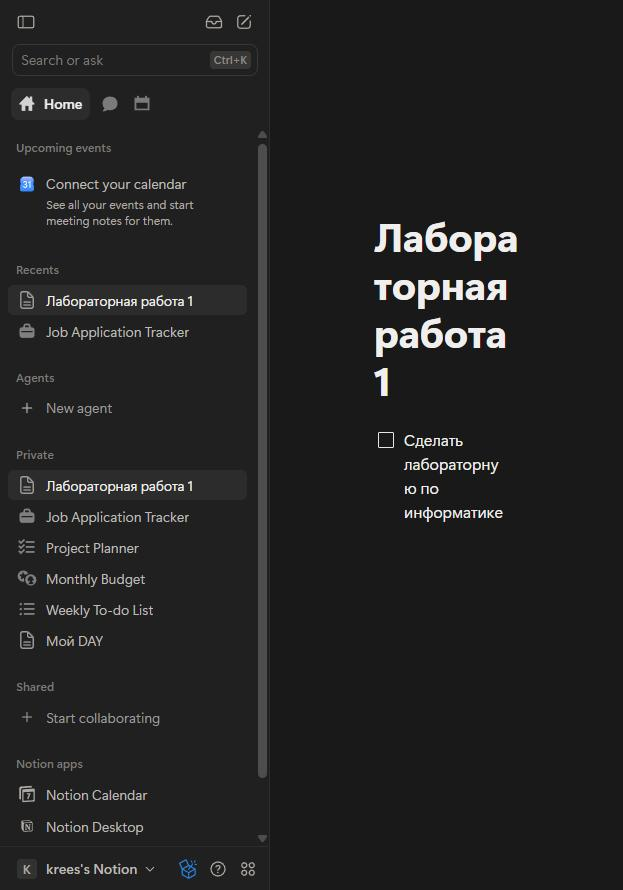
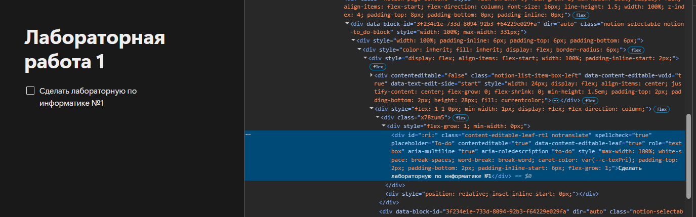
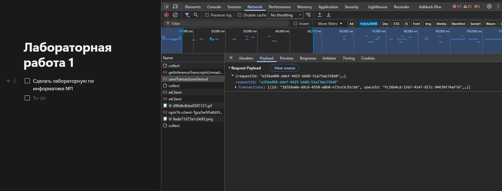
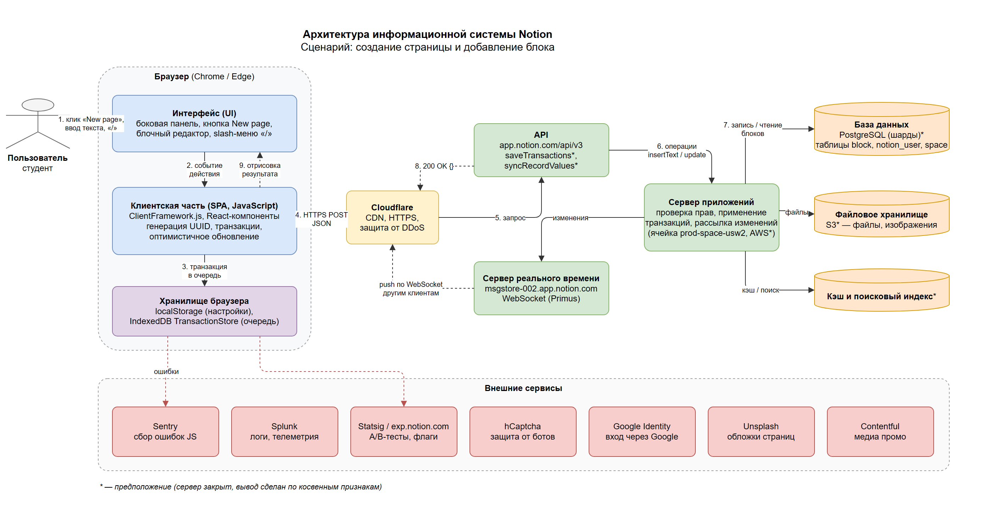

# Анализ информационной системы

## 1. Описание системы

**Название:** Notion

**Ссылка:** https://www.notion.so/ 

**Назначение:**
Notion — облачный SaaS-сервис (Software as a Service) для заметок, документов, баз знаний и управления задачами.
Всё содержимое хранится в виде страниц, а каждая страница состоит из блоков (текст, заголовки, списки,
таблицы, изображения и т.д.). Работает в браузере, а также в desktop- и мобильных приложениях
с синхронизацией через облако.

**Целевая аудитория:**

- Студенты: конспекты, планирование учёбы.
- Команды и компании: база знаний, документация, совместная работа.
- Фрилансеры и частные пользователи: личные заметки, трекеры задач и привычек.

**Основные возможности:**

- Создание страниц и вложенных подстраниц.
- Блочный редактор (текст, заголовки, списки, чек-листы, код, изображения, таблицы).
- Базы данных (таблицы, канбан-доски, календари).
- Совместное редактирование в реальном времени и комментарии.
- Шаблоны.
- Встроенный ИИ-помощник (Notion AI).
- Синхронизация между устройствами.

**Выбранный сценарий:**
Создание страницы и добавление блока.

В рамках сценария пользователь создаёт в своём рабочем пространстве новую страницу, задаёт ей заголовок,
добавляет на страницу блок (чек-лист To-do) через меню блоков, заполняет его текстом и проверяет результат.

## 2. Анализ пользовательского интерфейса

### 2.1. Основные страницы и разделы

В рамках лабораторной работы исследуется информационная система Notion — облачный сервис для заметок
и управления информацией.

В системе используются следующие основные страницы и разделы:

- Главная (публичная) страница Notion.
- Страница авторизации и регистрации.
- Рабочее пространство пользователя (Workspace) с боковой панелью.
- Раздел Home (последние страницы, события календаря).
- Список страниц: Recents, Private, Shared.
- Страница-документ с блочным редактором.
- Меню выбора блока (slash-меню).
- Поиск и Notion AI.
- Настройки доступа и публикации страницы (Share).
- Настройки рабочего пространства и аккаунта.

Часть разделов, включая рабочее пространство, список страниц и редактор, доступна только после авторизации
пользователя.

### 2.2. Ключевые элементы интерфейса

| Элемент интерфейса | Назначение |
|---|---|
| Боковая панель (Sidebar) | Навигация по рабочему пространству, список страниц (Recents, Private, Shared) |
| Кнопка «New page» (иконка карандаша) | Открывает меню создания: Page, Chat, AI Meeting Notes, Database |
| Поиск (Search or ask, Ctrl+K) | Поиск по страницам и вопросы к Notion AI |
| Заголовок страницы | Название страницы; отображается также в боковой панели и во вкладке браузера |
| Блочный редактор | Основная рабочая область: страница состоит из блоков |
| Slash-меню («/») | Выбор типа нового блока: Text, Heading, To-do list, Table и др. |
| Блок To-do | Элемент чек-листа с флажком |
| Маркер блока (⋮⋮ и «+») | Перемещение блока и добавление нового блока рядом |
| Шапка страницы (Share, избранное, «…») | Доступ, публикация, настройки страницы |
| Переключатель рабочего пространства | Смена workspace и аккаунта |

### 2.3. Выполнение пользовательского сценария

Выбранный сценарий: создание страницы и добавление блока в Notion.

Для выполнения сценария использовалось личное рабочее пространство в notion.

Последовательность действий:

1. Открыть сайт Notion.
2. Выполнить авторизацию.
3. Открыть рабочее пространство (боковая панель со списком страниц).
4. Нажать кнопку «New page» в боковой панели.
5. В меню создания выбрать пункт **Page**.
6. Ввести заголовок страницы «Лабораторная работа 1».
7. Нажать Enter, чтобы перейти к первому блоку страницы.
8. Ввести символ «/» и открыть меню блоков.
9. Найти блок **To-do list** (через поиск в меню).
10. Выбрать блок и добавить его на страницу.
11. Ввести текст блока «Сделать лабораторную по информатике».
12. Проверить, что страница появилась в боковой панели, а блок — на странице.

В результате выполнения сценария создана новая страница с блоком To-do.

### 2.4. Компоненты, участвующие в сценарии

| Компонент интерфейса | Назначение | Этап сценария |
|---|---|---|
| Форма авторизации | Вход в аккаунт | 2 |
| Боковая панель | Доступ к рабочему пространству и списку страниц | 3, 12 |
| Кнопка «New page» | Запуск создания новой страницы | 4 |
| Меню создания | Выбор типа объекта (Page) | 5 |
| Заголовок страницы | Ввод названия страницы | 6 |
| Блочный редактор | Отображение и редактирование содержимого страницы | 7–11 |
| Slash-меню | Выбор типа блока | 8–10 |
| Блок To-do | Результат сценария — чек-лист с текстом | 10–12 |

### 2.5. Скриншоты

#### Скриншот 1. Главный экран Notion

На скриншоте показано рабочее пространство пользователя: боковая панель со списком страниц и открытая страница.



#### Скриншот 2. Меню создания

На скриншоте показано меню, открывающееся по кнопке «New page».



#### Скриншот 3. Новая страница

На скриншоте показана созданная пустая страница «New page». Она сразу появилась в боковой панели.



#### Скриншот 4. Меню блоков

На скриншоте показан введённый заголовок и меню выбора блока (Text, Heading 1–4 и др.).



#### Скриншот 5. Добавленный блок

На скриншоте показан результат выполнения сценария — на страницу добавлен блок To-do
«Сделать лабораторную по информатике».



### 2.6. Вывод

В ходе анализа пользовательского интерфейса Notion были определены основные страницы системы, ключевые элементы
управления и компоненты редактора.

Выбранный сценарий состоит из следующих основных этапов:

- переход в рабочее пространство;
- создание новой страницы;
- ввод заголовка;
- открытие меню блоков;
- выбор блока To-do;
- заполнение блока текстом;
- проверка результата.

Интерфейс Notion построен вокруг блочного редактора: любая страница собирается из блоков, а новый блок
добавляется командой «/». Кнопки «Сохранить» нет — изменения сохраняются автоматически. Новая страница и её
заголовок мгновенно появляются в боковой панели, а в адресной строке — уникальный идентификатор страницы
(`https://app.notion.com/p/3f234e1e733d800cbb7bede76ed1299b`).

## 3. Анализ клиентской части

Клиентская часть Notion — одностраничное веб-приложение (SPA) на JavaScript. Браузер один раз загружает
приложение, а дальше страницы открываются и редактируются без перезагрузки.

### 3.1. Исследование HTML-структуры

Для анализа был выбран созданный в сценарии блок To-do «Сделать лабораторную по информатике».

Основные характеристики элемента:

- HTML-тег (упрощено):

```html
<div data-block-id="3f234e1e-733d-8094-92b3-f64229e029fa"
     class="notion-selectable notion-to_do-block">
  <div class="notion-list-item-box-left" contenteditable="false">
    <input type="checkbox" class="x10l6tqk xg01cxk xh8yej3 ...">
  </div>
  <div class="content-editable-leaf-rtl notranslate"
       contenteditable="true" role="textbox"
       placeholder="To-do" aria-roledescription="to-do">
    Сделать лабораторную по информатике
  </div>
</div>
```

- CSS-классы: `notion-selectable` (общий класс всех блоков), `notion-to_do-block` (тип блока),
  `notion-list-item-box-left` (область флажка), `content-editable-leaf-rtl` (редактируемый текст).
- Атрибут `data-block-id` — уникальный идентификатор блока (UUID) в базе данных Notion.
- Атрибут `contenteditable="true"` — текст редактируется прямо на странице.
- Вложенные элементы: флажок `<input type="checkbox">` и текстовое поле блока.

Скриншот HTML-структуры:



### 3.2. Исследование CSS

Стили Notion подключаются из файлов `main-….css`, `notifications-….css` и других. Часть оформления задаётся
автоматически сгенерированными атомарными классами (`x78zum5`, `x10l6tqk` и т.п.: каждый класс — одно свойство)
и inline-стилями, видимыми в панели Elements.

Основные свойства выбранного элемента:

| Свойство | Значение | Назначение |
|---|---|---|
| `display` | `flex` | Флажок и текст располагаются в одну строку |
| `padding-top` / `padding-bottom` | `2px` / `6px` | Внутренние отступы блока |
| `max-width` / `width` | `100%` | Блок растягивается на ширину страницы |
| `white-space` | `break-spaces` | Перенос длинного текста и сохранение пробелов |
| `word-break` | `break-word` | Перенос длинных слов |
| `caret-color` | `var(--c-texPri)` | Цвет курсора из CSS-переменной темы |
| `cursor` | `pointer` (флажок) | Вид курсора при наведении на флажок |

### 3.3. Исследование JavaScript

JavaScript реализует почти всё поведение Notion. В разделе **Sources** / **Network → JS** обнаружены
JavaScript-файлы, загружаемые вместе с приложением:

- `https://app.notion.com/_assets/ClientFramework-f9558892d7b387b3.js` — ядро клиентского приложения;
- `https://app.notion.com/_assets/primusV8-13b9d317b82abedd.js` — библиотека WebSocket-соединения;
- `https://app.notion.com/_assets/PresenceContainer-f57d53db1d4ac66e.js` — отображение присутствия других пользователей;
- `https://app.notion.com/_assets/contentPreview-9c63c27140a19dcc.js` и другие пронумерованные чанки.

JavaScript отвечает, в частности, за:

- обработку нажатий клавиш и кликов;
- открытие slash-меню и других элементов интерфейса;
- создание блоков и генерацию их идентификаторов (UUID);
- формирование транзакций и отправку их на сервер;
- обновление интерфейса без перезагрузки страницы (оптимистичное обновление);
- хранение очереди несохранённых изменений в IndexedDB (`TransactionStore`).

### 3.4. Загружаемые ресурсы

Статистика ресурсов, загруженных при открытии страницы и выполнении сценария:

| Тип | Пример | Количество | Назначение |
|---|---|---|---|
| Document | `app.notion.com/p/…` | 1 | Загрузка приложения |
| Script | `ClientFramework-….js` | 14 | Работа клиентской логики |
| Stylesheet | `main-0c0561606a3046fc.css` | 1+ | Оформление интерфейса |
| Image | обложки, иконки | 11 | Графические элементы |
| Fetch/XHR | `/api/v3/…` | 84 | Обмен данными с сервером |
| iframe / video | hCaptcha, промо-видео | 3 | Встроенные внешние элементы |
| **Всего** | | **113** | |

Локальное хранилище браузера (вкладка **Application**):

- `localStorage` — 63 ключа: настройки интерфейса, последние страницы, счётчики сессий;
- `IndexedDB` — `TransactionStore` (очередь изменений, ещё не подтверждённых сервером) и `statsigStore`
  (настройки A/B-экспериментов).

### 3.5. Анализ сетевых запросов

Все запросы к API — это `POST` на адреса вида `https://app.notion.com/api/v3/<метод>` с телом в формате JSON.

Примеры обнаруженных запросов:

| Запрос | Тип | Статус | Назначение |
|---|---|---|---|
| `POST /api/v3/saveTransactionsFanout` | Fetch/XHR | 200 | Сохранение изменений: страница, блок, текст |
| `POST /api/v3/saveTransactionsMain` | Fetch/XHR | 200 | Сохранение изменений (основной канал) |
| `POST /api/v3/syncRecordValuesMain` | Fetch/XHR | 200 | Получение актуальных данных страниц и блоков |
| `POST /api/v3/syncRecordValuesSpaceInitial` | Fetch/XHR | 200 | Начальная загрузка данных рабочего пространства |
| `POST /api/v3/recordPageVisit` | Fetch/XHR | 200 | Фиксация посещения страницы (Recents) |
| `POST /api/v3/getPageVisitors` | Fetch/XHR | 200 | Кто ещё просматривает страницу |
| `POST /api/v3/getBacklinksForBlockInitial` | Fetch/XHR | 200 | Обратные ссылки на страницу |
| `POST /api/v3/detectPageLanguage` | Fetch/XHR | 200 | Определение языка страницы |
| `POST /api/v3/etClient` | Fetch/XHR | 200 | Отправка аналитических событий |
| `GET _assets/ClientFramework-….js` | Script | 200 | Загрузка JavaScript |
| `GET _assets/main-….css` | Stylesheet | 200 | Загрузка CSS |

### 3.6. Запрос при добавлении блока

При редактировании блока To-do (в блок дописан текст « №1») в разделе Network обнаружен запрос сохранения.

Основные параметры:

- Метод: `POST`
- URL: `https://app.notion.com/api/v3/saveTransactionsFanout`
- Тип: `Fetch/XHR`
- Статус: `200 OK`
- Заголовки (часть): `Content-Type: application/json`, `notion-client-version: 23.13.20261007.1207`,
  `x-notion-space-id: fc26b4cd-…`, `x-notion-cell-hint: prod-space-usw2-0002`
- Данные запроса: ID рабочего пространства, ID блока, команда `insertText` с добавленным текстом и команды
  `update` с временем последнего изменения блока и страницы
- Ответ: `{}` — сервер подтвердил приём изменений

Тело запроса (сокращено):

```json
{
  "requestId": "8bc8a2f1-…",
  "transactions": [{
    "spaceId": "fc26b4cd-…",
    "debug": { "userAction": "Text.handleMutation" },
    "operations": [
      {
        "command": "insertText",
        "pointer": { "table": "block", "id": "3f234e1e-733d-8094-92b3-f64229e029fa" },
        "args": { "content": " №1" }
      },
      {
        "command": "update",
        "pointer": { "table": "block", "id": "3f234e1e-733d-8094-92b3-f64229e029fa" },
        "args": { "last_edited_time": 1791388983143, "last_edited_by_table": "notion_user" }
      },
      {
        "command": "update",
        "pointer": { "table": "block", "id": "3f234e1e-733d-800c-bb7b-ede76ed1299b" },
        "args": { "last_edited_time": 1791388983143 }
      }
    ]
  }]
}
```

Скриншот запроса:



### 3.7. Вывод

В ходе анализа клиентской части Notion были изучены:

- HTML-структура блока To-do;
- CSS-классы и основные стили;
- JavaScript-файлы и их роль в работе интерфейса;
- загружаемые ресурсы и локальное хранилище браузера;
- сетевые запросы браузера.

Установлено, что клиентская часть отвечает за отображение редактора, обработку действий пользователя и обмен
данными с сервером. При редактировании на сервер передаётся **не страница целиком, а операция**: «вставить текст
" №1" в блок с таким ID». Идентификатор блока один и тот же в HTML (`data-block-id`), в запросе и в базе данных;
ID страницы совпадает с ID в адресной строке.

## 4. Анализ серверной части и API

### 4.1. Серверная часть

Серверная часть Notion отвечает за операции, требующие обработки и хранения данных на сервере.

В рамках сценария «Создание страницы и добавление блока» выполняются следующие серверные операции:

| Операция | API-метод | Почему выполняется на сервере |
|---|---|---|
| Аутентификация, проверка сессии | вход, cookie сессии | Нельзя доверять клиенту проверку прав |
| Проверка прав доступа к странице | при каждом запросе | Пользователь видит только свои / открытые ему страницы |
| Создание страницы и блока | `saveTransactionsMain/Fanout` | Данные должны храниться постоянно и быть доступны с других устройств |
| Применение операций редактирования (`insertText`, `update`) | `saveTransactionsFanout` | Сервер объединяет правки нескольких пользователей |
| Выдача данных страниц и блоков | `syncRecordValuesMain`, `syncRecordValuesSpaceInitial` | Данные хранятся централизованно |
| Рассылка изменений другим клиентам | WebSocket `msgstore-002.app.notion.com` | Совместное редактирование в реальном времени |
| Учёт посещений, присутствие на странице | `recordPageVisit`, `getPageVisitors` | Общие для всех устройств данные |
| Определение языка, ИИ-функции | `detectPageLanguage`, `getInferenceTranscripts…` | Требуют серверных вычислений |

Код сервера закрыт, поэтому часть выводов основана на наблюдаемых запросах и заголовках ответов.
Выводы, которые нельзя проверить напрямую, помечены как **предположение**.

### 4.2. Передаваемые данные

| Направление | Данные |
|---|---|
| Клиент → сервер | Операции над записями: команда (`insertText`, `update`), указатель на запись (`table: block`, `id`), аргументы (текст, время изменения, ID автора); ID рабочего пространства; версия клиента; cookie сессии |
| Сервер → клиент | Записи блоков и страниц в JSON (содержимое, тип, родитель, порядок дочерних блоков, права); подтверждение сохранения (`{}`, статус 200); уведомления об изменениях по WebSocket |

Данные передаются в теле HTTP-запроса (JSON) и в заголовках (`x-notion-space-id`, `notion-client-version`).

Модель данных: **всё является блоком**. Страница — это блок типа `page`, внутри которого хранится список ID
дочерних блоков. Поэтому и блок To-do, и страница обновляются как записи таблицы `block`.

### 4.3. API и сетевое взаимодействие

Клиентская часть обменивается данными с сервером через HTTP API `/api/v3/…` (запросы типа `Fetch/XHR`)
и через WebSocket-соединение для получения изменений в реальном времени.

Пример наблюдаемого запроса:

| Параметр | Значение |
|---|---|
| Метод | POST |
| Тип | Fetch/XHR |
| URL | `/api/v3/saveTransactionsFanout` |
| Статус | 200 OK |
| Назначение | Сохранение изменений блока на сервере |
| Данные | ID пространства, ID блока, операции `insertText` / `update` |

Заголовки ответа сервера (запрос `POST /api/v3/getSpaces`):

| Заголовок | Значение | Что это значит |
|---|---|---|
| `server` | `cloudflare` | Перед серверами Notion стоит Cloudflare (CDN, защита от DDoS) |
| `cf-ray` | `…-ARN` | Запрос обработан узлом Cloudflare в Стокгольме, ближайшим к пользователю |
| `cf-cache-status` | `DYNAMIC` | Ответы API не кэшируются — данные персональные |
| `content-type` | `application/json` | Обмен данными в формате JSON |
| `content-encoding` | `gzip` | Ответ сжимается |
| `x-notion-request-id` | UUID | ID запроса для поиска в логах сервера |
| `server-timing` | `r;dur=513` | Время обработки на сервере — 513 мс |
| `strict-transport-security` | `max-age=31536000…` | Только HTTPS-соединение |

В запросах клиента передаётся заголовок `x-notion-cell-hint: prod-space-usw2-0002`: серверы разделены на «ячейки»,
и рабочее пространство закреплено за одной из них; `usw2` — **предположительно** регион AWS us-west-2.

Скриншот сетевого запроса: см. раздел 3.6.

### 4.4. Внешние сервисы

В ходе анализа были обнаружены следующие внешние домены:

| Домен | Запросов | Назначение |
|---|---|---|
| `app.notion.com` | 74 | Само приложение и его API |
| `msgstore-002.app.notion.com` | — | WebSocket-сервер изменений в реальном времени |
| `exp.notion.com` | 20 | Эксперименты и feature-флаги (Statsig, A/B-тесты) |
| `o324374.ingest.sentry.io` | 11 | Sentry — сбор ошибок JavaScript |
| `http-inputs-notion.splunkcloud.com` | 3 | Splunk — сбор логов и телеметрии |
| `images.unsplash.com` | 2 | Unsplash — обложки страниц |
| `newassets.hcaptcha.com` | 2 | hCaptcha — защита от ботов |
| `accounts.google.com` | — | Вход через аккаунт Google |
| `videos.ctfassets.net` | 1 | Contentful CDN — медиа для промо-окон |
| Cloudflare (заголовок `server`) | — | CDN, проксирование, защита от DDoS |

### 4.5. Хранилища данных

Внутренние хранилища Notion из браузера не видны. По функциям системы и косвенным признакам можно предположить:

| Хранилище | Назначение | Основание |
|---|---|---|
| Реляционная БД (PostgreSQL, шардированная) | Блоки, страницы, пространства, пользователи, права | **Предположение**; подтверждается публичными статьями Notion о шардировании PostgreSQL; в запросах видны таблицы `block`, `notion_user` |
| Файловое / объектное хранилище (S3) | Загружаемые файлы и изображения | **Предположение** |
| Кэш | Быстрый доступ к часто используемым данным, сессии | **Предположение** |
| Поисковый индекс | Поиск по страницам (Ctrl+K) | **Предположение** |
| Хранилище логов и аналитики | События, логи, ошибки | Подтверждено: Splunk, Sentry, `etClient` |
| Браузерное хранилище | Настройки (`localStorage`), очередь изменений (`IndexedDB: TransactionStore`) | Подтверждено в DevTools → Application |

### 4.6. Общая схема взаимодействия

На основании проведённого анализа роль компонентов можно описать так:

- **Cloudflare** — первая точка входа: принимает HTTPS-запрос, защищает и передаёт его серверу Notion.
- **API-сервер (`/api/v3/…`)** — проверяет права, принимает транзакции, читает и записывает данные.
- **Сервер реального времени (`msgstore`, WebSocket)** — рассылает изменения всем, кто открыл страницу.
- **База данных** — постоянно хранит все блоки и страницы.
- **Внешние сервисы** — мониторинг, аналитика, вход через Google, защита от ботов, медиа.

Упрощённо: **Браузер → Cloudflare → API → Сервер приложений → База данных**, а изменения возвращаются
обратно в браузер и рассылаются другим клиентам через WebSocket. Полная схема приведена в разделе 6.

## 5. Описание пользовательского сценария

### 5.1. Выбранный сценарий

Название сценария: создание страницы и добавление блока в Notion.

Цель сценария: создать новую страницу в рабочем пространстве и добавить на неё блок To-do с текстом.

### 5.2. Последовательность выполнения сценария

#### Этап 1. Пользователь создаёт страницу

Пользователь нажимает кнопку «New page» в боковой панели и выбирает **Page**.

Интерфейс сразу открывает пустую страницу «New page» и добавляет её в боковую панель. JavaScript сам генерирует
UUID новой страницы (`3f234e1e-733d-800c-…`) и записывает транзакцию в локальную очередь (`IndexedDB`).

#### Этап 2. Клиентская часть отправляет запрос

Клиент формирует запрос `POST /api/v3/saveTransactionsMain` с операцией создания блока типа `page`
и добавления его в список страниц рабочего пространства.

#### Этап 3. Сервер обрабатывает запрос и сохраняет данные

Сервер проверяет сессию и права на рабочее пространство, применяет операции транзакции. В таблице `block`
появляется запись новой страницы. Клиент получает ответ `200`, транзакция удаляется из локальной очереди.

#### Этап 4. Пользователь вводит заголовок

Пользователь вводит «Лабораторная работа 1». Текст сразу отображается в редакторе, в боковой панели и во вкладке
браузера. Клиент отправляет `POST /api/v3/saveTransactionsFanout` с изменением свойства `title` страницы;
сервер сохраняет его и рассылает через WebSocket другим открытым клиентам.

#### Этап 5. Пользователь добавляет блок

Пользователь нажимает Enter, вводит «/» и выбирает **To-do list**. Slash-меню строится на клиенте, запрос к серверу
не нужен. Клиент генерирует UUID блока (`3f234e1e-733d-8094-…`) и отправляет транзакцию: создать запись `block`
с типом `to_do` и добавить её ID в список содержимого страницы.

#### Этап 6. Пользователь вводит текст блока

Пользователь вводит «Сделать лабораторную по информатике» (затем дописывает « №1»). Клиент отправляет
`POST /api/v3/saveTransactionsFanout` с операциями `insertText` и `update` (см. раздел 3.6).
Сервер применяет их и отвечает `200 OK` с телом `{}`.

#### Этап 7. Интерфейс отображает результат

Блок с флажком и текстом отображается на странице сразу, не дожидаясь ответа сервера (оптимистичное обновление).
После перезагрузки страницы текст на месте — данные сохранены на сервере.

### 5.3. Общая последовательность

```
Пользователь → действие в интерфейсе (New page, «/», ввод текста)
  → JavaScript обновляет интерфейс сразу и создаёт транзакцию (UUID, операции)
  → транзакция сохраняется в IndexedDB (очередь)
  → HTTPS POST /api/v3/saveTransactions… (JSON) → Cloudflare → API
  → сервер проверяет права и применяет операции → база данных (таблица block)
  → ответ 200 {} → транзакция удаляется из очереди
  → сервер рассылает изменения другим клиентам по WebSocket
```

Особенности сценария:

1. **Оптимистичное обновление.** Интерфейс меняется до ответа сервера — пользователь не ждёт сети.
2. **ID создаёт клиент.** UUID страницы и блока генерируются в браузере.
3. **Передаются операции, а не документ целиком.** Это экономит трафик и позволяет нескольким людям
   редактировать одну страницу одновременно.
4. **Локальная очередь изменений.** Пока сервер не подтвердил транзакцию, она хранится в IndexedDB,
   поэтому правки не теряются при обрыве соединения.
5. **Нет кнопки «Сохранить».** Всё сохраняется автоматически.

## 6. Построение архитектурной схемы

### 6.1. Архитектурная схема

Для варианта 5 построена архитектурная схема информационной системы Notion в diagrams.net (draw.io).
Исходный файл: [`diagrams/system_architecture.drawio`](../diagrams/system_architecture.drawio).

На схеме представлены основные компоненты:

- пользователь;
- браузер;
- пользовательский интерфейс;
- клиентская часть (SPA);
- хранилище браузера;
- Cloudflare;
- API;
- сервер приложений и сервер реального времени;
- хранилища данных (база данных, файловое хранилище, кэш и поисковый индекс);
- внешние сервисы.

Схема показывает направление взаимодействия между компонентами при выполнении сценария создания страницы
и добавления блока.

### 6.2. Взаимодействие компонентов

Номера на стрелках схемы соответствуют порядку шагов:

1. Пользователь выполняет действие в интерфейсе (клик «New page», ввод текста, «/»).
2. Интерфейс передаёт событие клиентской части.
3. Клиентская часть ставит транзакцию в локальную очередь (IndexedDB).
4. Клиентская часть отправляет HTTPS POST-запрос с JSON-транзакцией.
5. Cloudflare передаёт запрос к API Notion.
6. API передаёт операции `insertText` / `update` серверу приложений.
7. Сервер приложений записывает и читает блоки в базе данных.
8. Сервер возвращает ответ `200 OK {}`.
9. Клиентская часть отображает результат в интерфейсе (фактически — сразу, оптимистично).

Дополнительно сервер рассылает изменения другим клиентам через сервер реального времени (WebSocket),
а браузер обращается к внешним сервисам (Sentry, Statsig и др.).
Звёздочкой (*) на схеме отмечены предположения.

### 6.3. Архитектурная схема



## 7. Вывод

В ходе работы проанализировано устройство SaaS-сервиса Notion на примере сценария
«создание страницы и добавление блока».

1. Notion — клиент-серверная информационная система. Клиентская часть — одностраничное приложение (SPA)
   на JavaScript, которое отрисовывает интерфейс и выполняет логику редактора в браузере.
2. Клиент и сервер обмениваются данными через собственный HTTP API (`/api/v3/…`) в формате JSON.
   При редактировании передаются не страницы целиком, а небольшие операции (транзакции) над блоками.
3. Основная модель данных — блок: страница тоже является блоком; каждый блок имеет UUID,
   который виден и в HTML (`data-block-id`), и в адресной строке, и в теле запроса.
4. Для быстрой работы используется оптимистичное обновление интерфейса и локальная очередь изменений
   в IndexedDB; для совместной работы — WebSocket-сервер, рассылающий изменения в реальном времени.
5. Система опирается на внешние сервисы: Cloudflare (CDN и защита), Sentry и Splunk (мониторинг),
   Statsig (эксперименты), hCaptcha (защита от ботов), Google (вход), Unsplash (изображения).

Работа показала, что даже простое действие пользователя — добавление строки в заметку — проходит через
несколько слоёв системы: интерфейс, клиентскую логику, локальное хранилище, сеть, API, сервер и базу данных.
